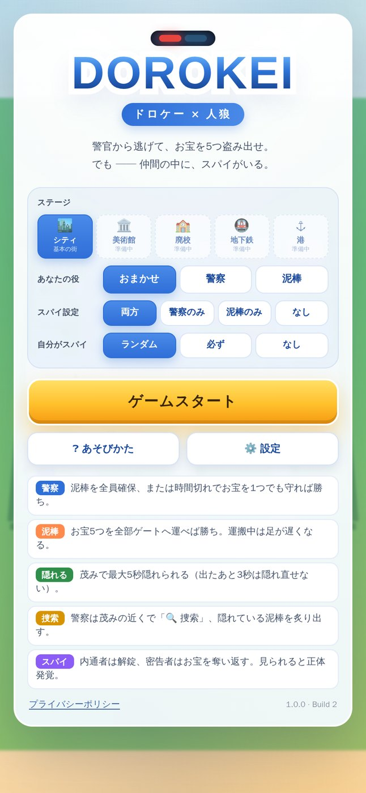
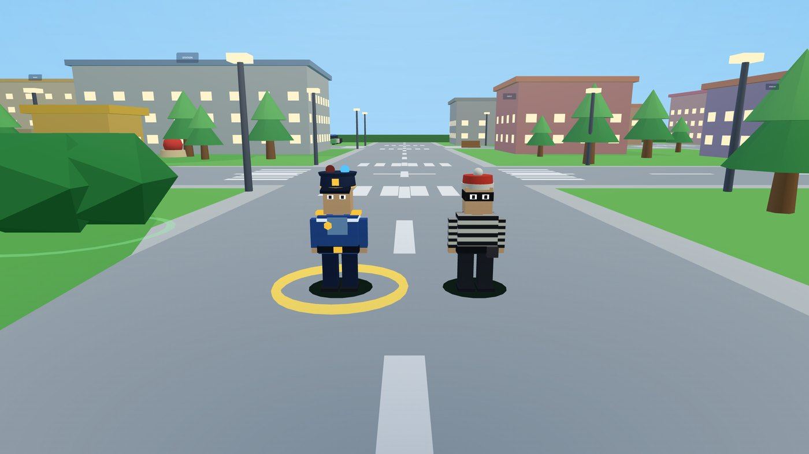
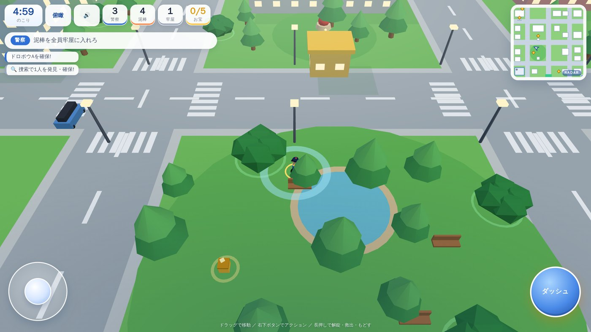
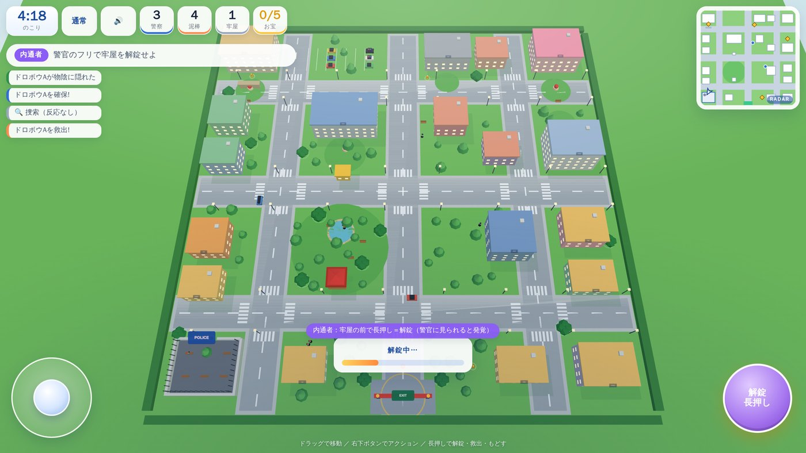

# DOROKEI — ドロケー × 人狼（Build 3：決定版アイコン・警察署の中の牢屋・15秒拘束→寝返り・HUD整理）

警官と泥棒の鬼ごっこ（ドロケー）に、人狼の「スパイ」を混ぜた 3D アクション。
HTML/CSS/JS + Three.js（CDN 不使用・`www/vendor/three.module.js` に同梱）だけで動き、
Capacitor の iOS シェル（`ios/`）でそのままアプリになります。ビルド工程はありません。

- プレイヤー1人 + CPU 8人（警察3 対 泥棒5、各陣営にスパイ0〜1）
- **150m × 150m** の広い街（銀行・宝石店・美術館・公園・駅・商店街・駐車場・路地・警察署）
- 右上に **ミニマップ（レーダー）**、左下バーチャルスティック、右下の文脈アクションボタン
- お宝は **10箇所の候補から5個** をランダム配置（捕まった時・奪い返された時は別の場所へ隠し戻し）

## Build 3 で入ったもの（実機フィードバック＋採用した提案）

1. **アプリアイコンを決定版に差し替え**：人狼警察（舌ペロでお宝）／黒マスクに警察バッジ＋無線＋手錠の
   人狼泥棒の絵（`assets/dorokei-appicon-1024.png` → `ios/App/App/Assets.xcassets/AppIcon.appiconset/`）。
   1024×1024・RGB・透過なしの PNG に整えて配置（`npm run appicon` で再生成）。
2. **画面中央のHUDを撤去して視界をクリアに**：中央に浮いていた役割バナー・案内を左上の1列
   （`hud-stack`）と左端（`note-rail`）へ移動。長押しゲージ・隠れゲージは右下のアクションボタンの上へ。
   ミニマップ／タイマー／操作ボタンと重ならないよう、iPhone 縦・横の両方で調整。
3. **自分の役＋やるべきことの常時表示**：左上の `role-card` に「役バッジ＋1行ミッション」を常時表示
   （例：`👮 警察｜泥棒を確保しろ`、`🐺 人狼警察｜牢屋を解錠しろ`、`🕵️ 潜入捜査官（FBI）｜運ばれた宝を戻せ`）。
   拘束中は `🔒 15秒拘束中｜あと◯秒後に泥棒へ転向`、寝返り直後は `🎭 泥棒｜お宝をゲートへ運べ` へ即切替。
4. **警察署の中に牢屋**：警察署の建物（奥）＋白壁に青帯＋中央が吹き抜けの屋根で「署の中の牢屋」に。
   牢屋の床は**タイルの明るい白**（`JAIL` の文字入り）＋投光照明＋ポイントライトで中の状況が一目で分かる。
5. **牢屋・拘束中はスティックで俯瞰カメラ**：牢屋に入っている間（と後の15秒拘束中）は、左スティックで
   カメラだけを動かして街の他のプレイヤーを観察できる。自キャラのマーカーは牢屋の位置に残る。
6. **スパイの呼び名を整理**：片側だけスパイ（`cops`／`thieves`）の時はどちらも **「人狼（スパイ）」**、
   双方（`both`）の時は警察側の敵＝**「人狼警察」**、泥棒側の警察スパイ＝**「潜入捜査官（FBI）」**
   （14言語の土台に対応：`role.copSpy` / `role.thiefSpy` / `role.spyUnified`）。
7. **スパイ発覚 → 牢屋で15秒拘束 → 相手陣営へ寝返り（1試合1回）**：現場を相手陣営に見られると即逮捕ではなく
   警察署の牢屋へ移送し、15秒間停止＋俯瞰カメラ。15秒後に**見た目どおりの陣営の通常メンバーへ強制転向**
   （人狼警察→警察、潜入捜査官→泥棒）。見た目・チーム・勝利判定・HUDも切り替わる。
   わざとバレて寝返る利敵行為を防ぐため、**発覚した時だけ・1試合1回限り**。
8. **プレイ中の MENU**：HUD上部の `☰` から「つづける／🏠 ホーム（タイトル）へ／サウンド／あそびかた／設定」。
   ホームへは確認ダイアログ付き。メニュー中は試合が止まる。
9. **Build 3 として配信**：`CURRENT_PROJECT_VERSION = 3`。ワークフローは `docs/ios-testflight-build3.yml`
   （`BUILD_NUMBER: "3"`・preflight も `= 3;`）。

## Build 2 で入ったもの（トモアキさんの実機フィードバック反映）

1. **世界基準のキャラクター**
   - 警察：紺のポリスユニフォーム＋金の肩章・胸バッジ＋つば付き制帽（金帯・帽章）＋赤青のパトライト
   - 泥棒：黒×白ボーダー＋目出しマスク＋**赤いニット帽**（白の折り返し＋ポンポン）＋背中のお宝袋。
     お宝を運ぶと**背中の宝箱が金色に光る**。色もシルエット（制帽のつば／ニット帽＋袋）も別物
2. **茂みに隠れる秒数制限**：1回 **最大5秒**（残り秒数のゲージ表示）＋解除後 **クールタイム3秒**
3. **警察の「捜索」**：茂みの**5.5m以内**で右下ボタンが金色の「🔍 捜索」に変わり、押すと足元から
   サーチ波紋が広がって**4.5m以内の隠れている泥棒を即・炙り出して確保**（自動で3.2mまで近づいても見つかる）
4. **効果音＆BGM（Web Audio API 合成・音声ファイルなし／完全オフライン）**
   開始・お宝ゲット・ゲート納品・泥棒確保（サイレン風）・牢屋解錠・お宝隠し戻し・スパイ発覚（警告音）・
   茂み隠れ／捜索・ボタンタップ・勝利／敗北ジングル・軽快なチェイスBGM。
   タイトル設定とゲーム中HUD（🔊）でサウンドON/OFF
5. **ステージ整理＆UI整備**
   - 今の街を基本ステージ **`City`** として登録。建物ラベルは控えめな街の景観に。
     タイトルに**ステージ選択枠**（City＋「🏛️ 美術館」「廃校」「地下鉄」「港」の Coming Soon）
   - **あそびかた**（操作説明＋ルール図解）、**設定**（制限時間3分/5分/7分・サウンドON/OFF・
     言語14種〈日本語・英語＋12言語の土台〉）、**プライバシーポリシー** をタイトルから即オープン
6. **Build 2 として配信**：`CURRENT_PROJECT_VERSION = 2`。ワークフローの `BUILD_NUMBER = 2` 版は
   `docs/ios-testflight-build2.yml` に用意（GitHub連携の権限ではワークフローファイルを更新できないため、
   Build 1 と同じく Safari で貼り付けてもらう）

## 起動

```bash
cd /workspace/work/dorokei-game
PATH=/workspace/.tools/node22/bin:$PATH npm test        # ルール＋Build 2/3のユニットテスト（56本）
PATH=/workspace/.tools/node22/bin:$PATH npm run serve   # http://127.0.0.1:8899/
```

`www/` をそのまま Capacitor の `webDir` に指定しています（相対パス・ES Modules のみ、外部通信なし）。

### デモ用URLパラメータ（スクリーンショット／動作確認用）

| パラメータ | 例 | 意味 |
|---|---|---|
| `demo=1` | `?demo=1` | 全員CPUのオートプレイで開始（HUD表示） |
| `warp=42` | | 開始時に42秒ぶん早送り（賑やかな場面を作る） |
| `seed=7` | | 乱数シード（役割・お宝の配置・AIの動きが再現） |
| `team=cop\|thief` | | プレイヤーの希望陣営 |
| `spy=both\|cops\|thieves\|none` | | スパイ設定 |
| `duration=180` | | 制限時間（秒） |
| `view=top` | | 自分中心の俯瞰で開始 |
| `view=map` | | 街全体を見渡すカメラで開始（スクリーンショット用） |
| `hud=0` | | HUDを隠す |
| `chars=1` | | 警官と泥棒のキャラ図鑑カメラ（撮影用・`carry=1`／`back=1` 併用） |

## ルール（最新仕様）

| 役 | 見た目 | 本当の陣営 | できること |
|---|---|---|---|
| 警察 COP | 紺のポリス服・制帽・赤青ランプ | 警察 | 泥棒に触れると確保（クールダウン4秒）。牢屋へ収容。茂みの近くで **🔍 捜索**。ボタン長押しでダッシュ |
| 内通者 COP SPY | 警官のフリ | **泥棒** | 牢屋の前で1.5秒長押し＝解錠して脱獄させる。警官に7.5m以内で見られると正体発覚 |
| 泥棒 THIEF | ボーダー・目出し・赤ニット帽 | 泥棒 | お宝を回収→脱出ゲートへ。牢屋の前で1.5秒長押し＝仲間を救出。茂みに**最大5秒**隠れる |
| 密告者 THIEF SPY | 泥棒のフリ | **警察** | ボタンで近く（11m以内）の泥棒を警察へ密告ピン。ゲート前で1.5秒長押し＝運ばれたお宝を隠し戻す。泥棒に見られると発覚 |

**勝利条件**

- **警察陣営**：泥棒を全員牢屋に入れる／時間切れ（既定300秒、設定で3分・5分・7分）でお宝を**1つでも守りきる**
- **泥棒陣営**：お宝**5個すべて**を脱出ゲートへ運ぶ

**細部**

- **お宝運搬中の速度低下**：通常 6.8 m/s → 運搬中 **5.4 m/s**（警官 6.4 m/s・ダッシュ時 ×1.3）
- **お宝を持ったまま捕まった場合**：泥棒は牢屋へ、お宝は街の候補スポットへ**ランダムに隠し戻される**
- **隠れる**：茂みの中でアクション → 半透明になり、3.2m まで近づかれないと見つからない。
  **1回5秒まで**（残りゲージ表示）、解除後**3秒**は隠れ直せない。動くと解除／お宝持ちは不可。
  隠れている間は自分が入っている茂みが透けて自分の位置が見える
- **捜索**：警察が茂みの**5.5m以内**にいるとボタンが「🔍 捜索」に光る。押すと足元から波紋が広がり、
  **4.5m以内**の隠れている泥棒を炙り出して確保。クールタイム1.6秒（CPU警官も捜索する）
- **警察側スパイの解錠**：牢屋前で1.5秒。**他の警察に7.5m以内で見られると正体発覚**
- **泥棒側スパイの奪い返し**：ゲート前で1.5秒。**他の泥棒に7.5m以内で見られると正体発覚**
- **正体発覚後**：元の陣営（内通者なら警察、密告者なら泥棒）からも捕まえて牢屋へ送れる
- **スパイ自身は捕まえる側に回れない**（捜索も不可。正体を隠しているため）

タイトルで「ステージ」「あなたの役（おまかせ／警察／泥棒）」「スパイ設定（両方／警察のみ／泥棒のみ／なし）」
「自分がスパイ（ランダム／必ず／なし）」を選べます。設定は端末内（localStorage）に保存されます。

## 操作

| 操作 | スマホ | PC |
|---|---|---|
| 移動 | 左下スティックをドラッグ | WASD / 矢印キー |
| アクション | 右下ボタン（泥棒=隠れる／警察=捜索・ダッシュ／長押しで解錠・救出・奪い返し） | Space |
| 視点切替 | 左上「俯瞰／通常」 | V |
| サウンドON/OFF | HUD右上の 🔊 | 設定モーダル |

## ステージ構成（次のビルドへの土台）

`www/src/stages.js` がステージ台帳です。Build 3 でも `City`（`available: true`）だけが遊べ、
美術館・廃校・地下鉄・港は「Coming Soon」としてタイトルに並びます。追加するときは
`STAGES` に1件足し、`available: true` と街データ（建物・ギミック）を用意します。
`Game({ stage: '<id>' })` は遊べないIDを受け取ると例外にするので、未実装ステージが
混ざることはありません。

## 音（Web Audio API）

`www/src/audio.js` がすべての音をオシレーター＋ノイズで合成します（音声ファイル0個・外部通信なし）。

- 効果音：`tap / start / pickup / deliver / arrest / unlock / rescue / hideback / expose / hide / search / whistle / win / lose`
- BGM：138BPMの軽快なチェイスループ（Am–F–C–G、ベース＋アルペジオ＋ハイハット）
- ゲームのイベント（`pickup` `deliver` `arrest` …）は `pickSfx()` で効果音名に変換され、
  勝利／敗北はプレイヤーの陣営で決まります。iOS はタップで `unlock()` してから鳴らします。

## 言語

`www/src/i18n.js` に **14言語**（日本語・English・한국어・简体中文・繁體中文・Español・Português・
Français・Deutsch・Italiano・Русский・ไทย・Tiếng Việt・Bahasa Indonesia）。
日本語と英語は全文、韓国語・中国語（簡体／繁体）は主要UIを翻訳し、残りは英語へフォールバックします。
未翻訳キーは英語→日本語の順で表示されるので、対応言語を足すときは `STRINGS` に追記するだけです。

## プライバシー

`docs/privacy.md`（同内容はアプリ内の「プライバシーポリシー」モーダル）。
個人情報の収集なし・アカウントなし・広告／解析なし・外部送信なし。設定のみ端末内に保存します。

## ファイル構成

```
www/
  index.html            タイトル / HUD / モーダル（あそびかた・設定・プライバシー）/ リザルト
  styles.css            明るいポップなUI（縦横どちらでも崩れない）
  vendor/three.module.js  Three.js（同梱・オフライン動作）
  src/core.js           コアロジック（描画非依存：役割・捕獲・牢屋・隠れ5秒・捜索・スパイ・勝敗・AI・A*）
  src/render.js         Three.js の街・キャラ（警官／泥棒）・牢屋・お宝・ゲート・捜索波紋・カメラ
  src/minimap.js        右上のレーダー
  src/audio.js          効果音＆BGMの合成（Web Audio API）
  src/stages.js         ステージ台帳（City＋Coming Soon）
  src/i18n.js           14言語の文字列とDOM適用
  src/main.js           UI配線・入力・設定の保存・モーダル・ゲームループ
test/core.test.js       既存ルールのユニットテスト（26本）
test/build2.test.js     Build 2のユニットテスト（14本：茂み5秒・捜索・ステージ・音・言語）
test/build3.test.js     Build 3のユニットテスト（16本：呼び名・15秒拘束→寝返り・牢屋/HUD・アイコン・ワークフロー）
tools/serve.mjs         依存なし静的サーバー
tools/shot.mjs          ヘッドレスChromiumでスクリーンショット撮影（タイトル・街・キャラ・隠れ・捜索）
tools/interaction-test.mjs  ブラウザ操作の自動確認（モーダル・設定・隠れ・捜索・言語・リザルト）
tools/portrait.mjs      iPhone縦持ち(390×844)のレイアウト確認
tools/make-icons.mjs    旧アイコン/スプラッシュの生成（Build 2まで）
tools/set-app-icon.py   決定版アイコン（assets/dorokei-appicon-1024.png）をアセットカタログへ配置
ios/                    Capacitor iOS プロジェクト（Xcode）
docs/privacy.md         プライバシーポリシー本文
docs/ios-testflight-build3.yml  Build 3 のワークフロー（Safariで .github/workflows/ へ上書きする用）
docs/ios-testflight-build2.yml  Build 2 のワークフロー（履歴）
```

## テスト結果

`npm test` → **56 / 56 pass**
ブラウザ操作 `node tools/interaction-test.mjs` → **INTERACTION OK**（Build 3 の役カード・MENU・
15秒拘束→寝返り・牢屋カメラ・縦横レイアウトも自動確認）

Build 2 で追加した確認（`test/build2.test.js`）:

- 茂みは1回**最大5秒**・解除後**クールタイム3秒**／残り秒数が毎フレーム減る／手動解除でもクールタイム
- 警察は茂み5.5m以内で捜索でき、4.5m以内の隠れた泥棒を炙り出して確保／波紋エフェクト／成績に加算
- 茂みから離れると捜索不可・4.5mより遠い隠れ泥棒には届かない・隠れていない泥棒は捜索では捕まらない
- 捜索のクールタイム／内通者は捜索できない／波紋は約0.75秒で消える
- ステージ台帳（Cityが基本・Coming Soonが2つ以上・遊べないIDは例外）／制限時間3・5・7分
- 終了イベントに勝者（勝敗ジングルの判定）／効果音名とイベント対応／AudioContextなしでも落ちない
- 14言語・全キーに ja/en が揃う・未翻訳は英語へフォールバック

既存の確認（`test/core.test.js`）も全て維持：役割割り当て、街の広さ、お宝の配置・搬出・勝利条件、
運搬中の速度低下、隠れる／発覚、内通者の解錠、密告者の奪い返し、密告ピン、A*の到達性、
CPU 8人の通し対戦（6シードで両陣営の勝ちが発生）・再現性。

ブラウザ操作（`node tools/interaction-test.mjs`）→ **INTERACTION OK**
（ステージ枠・準備中表示・あそびかた／設定モーダル・3分設定・サウンドOFF/ON・移動・視点・
ミニマップ・隠れ5秒→クールタイム3秒の表示・🔍 捜索で確保・リザルトの捜索成績・英語切替）

## スクリーンショット







- `docs/screenshots/dorokei-title.jpg` … ステージ選択・設定・あそびかたを備えた新タイトル
- `docs/screenshots/dorokei-chars.jpg` … 警官（紺の制服・制帽・金バッジ・パトランプ）と泥棒（ボーダー・目出し・赤ニット帽）
- `docs/screenshots/dorokei-chars-back.jpg` … お宝を運ぶ泥棒の背中（宝箱が光る）
- `docs/screenshots/dorokei-search.jpg` … 「🔍 捜索」の波紋と確保
- `docs/screenshots/dorokei-play.jpg` … 150m×150mの街全体・HUD・レーダー
- アプリアイコン：`assets/appicon-1024.png`

再撮影：`node tools/shot.mjs`（`ONLY=chars,search` などで個別に）。
ヘッドレス Chromium は `/workspace/work/dcd-b17/browsers` を使い、システムに無い libatk/libatspi は
`.browser-libs/`（Debian の .deb を展開）から供給しています。

## iOS（Capacitor）

| 項目 | 値 |
|---|---|
| Bundle ID | `jp.signlink.Dorokei` |
| アプリ名 | `DOROKEI` |
| バージョン | `1.0.0`（**Build 3**） |
| 対応 | iOS 15.0 以上 / iPhone・iPad / 縦横対応 / ステータスバー非表示 |
| 暗号化 | `ITSAppUsesNonExemptEncryption = false`（輸出コンプライアンスの質問をスキップ） |

```bash
npx cap sync ios     # www → ios/App/App/public を更新（要 Node 22）
npx cap open ios     # Xcode で開く（Macのみ）
```

### TestFlight 配信（Build 3）

Build 番号は `3` に更新済みですが、ワークフロー本体の `BUILD_NUMBER` も `3` にする必要があります。
GitHub連携の権限ではワークフローファイルを更新できないため、Build 1 と同じく Safari で貼り付けます。

1. Safari で `docs/ios-testflight-build3.yml` を開き、全文をコピー
2. GitHub の `signlinkjp/dorokei-game` → `.github/workflows/ios-testflight-build1.yml` → 鉛筆（Edit）
   → 全文を置き換えて Commit
3. Actions →「**DOROKEI iOS TestFlight**」→ Run workflow
   - `confirm_bundle_id` = `jp.signlink.Dorokei`
   - `upload_to_testflight` = **true**

貼り付けるまでは、既存ワークフローの preflight が「`CURRENT_PROJECT_VERSION = 3`」と「= 2」の
不一致で止まるので、古いビルド番号が TestFlight に出ることはありません。
Apple 側の準備（Bundle ID・App Store Connect のアプリ・GitHub Secrets）は Build 1 で完了済みです。

## 設計メモ / 次の一手

- コアは描画非依存なので、そのまま通信対戦（状態同期）やバランス調整の自動検証に回せます。
- ステージは `stages.js` の台帳＋`Game({stage})` で切り替える設計。次は美術館（展示室・監視カメラ）や
  廃校（5秒で閉まる密室）、地下鉄（ワープ）など、ICE WOLF の展開に合わせたギミックを足していきます。
- アイコンは Build 3 で決定版（人狼警察×人狼泥棒×宝）に差し替え済みです。
- 今後の候補：足音・視界などの情報戦、牢屋の格子越しの会話、スパイの告発（投票）、観戦カメラ。
