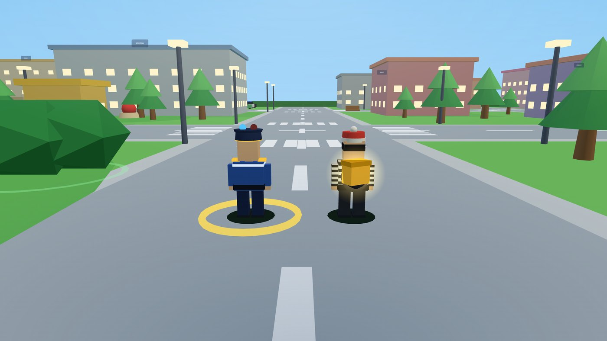

# DOROKEI — ドロケー × 人狼（Build 6：ホーム往復の音切れ対策・確保判定の手触り・役ヒントON/OFF・スパイだけ残った時の決着）

警官と泥棒の鬼ごっこ（ドロケー）に、人狼の「スパイ」を混ぜた 3D アクション。
HTML/CSS/JS + Three.js（CDN 不使用・`www/vendor/three.module.js` に同梱）だけで動き、
Capacitor の iOS シェル（`ios/`）でそのままアプリになります。ビルド工程はありません。

- プレイヤー1人 + CPU（**4〜10人**から選択。既定は8人＝警察3 対 泥棒5、各陣営にスパイ0〜1）
- **150m × 150m** の広い街（銀行・宝石店・美術館・公園・駅・商店街・駐車場・路地・警察署）
- 右上に **ミニマップ（レーダー）**、左下バーチャルスティック、右下の文脈アクションボタン
- お宝は **10箇所の候補から人数に応じて3〜5個** をランダム配置（捕まった時・戻された時は別の場所へ隠し戻し）

## Build 6 で入ったもの（Build 5 実機フィードバック：動画2本＋スクショ1枚＋4項目）

1. **iPhone ホーム画面との往復で音が出なくなる問題の徹底対策**（`audio.js` / `main.js` / `AppDelegate.swift`）：
   iOS の WKWebView では `AudioContext.state` が `'running'` のまま **`currentTime` だけが止まる**
   症状があり、この時 `resume()` も効かず、鳴らした音はすべて同じ時刻に予約されたまま永久に鳴らない。
   **時計の停滞（600ms 進まない）を検知して `AudioContext` ごと作り直す** `clockStalled()` /
   `_hardReset()` を追加し、`visibilitychange` / `pageshow` / `focus` で戻った瞬間に
   `resumeFromBackground()`（測り直し→必要なら作り直し）を呼ぶ。ネイティブ側も
   `applicationDidBecomeActive` で `AVAudioSession`（`.ambient` + `mixWithOthers`）を必ず取り直す。
   実機の画面収録を解析すると、Build 5 はホーム往復の瞬間（00:41:09 の動画では 0:53）から
   残り95秒が完全無音だった。今回の修正はその状態を毎回引き戻す。
2. **泥棒に触れているのに確保できないバグの修正**（`core.js`）：
   ① 確保距離 **1.9 → 2.35m**（体の半径0.62＋0.62＝1.24m より必ず外側）。
   ② 確保判定を「各キャラの移動直後」から **`separateAgents()`（押し合い）の後の再判定**へ移し、
      触れているフレームを取りこぼさない（`resolveArrests()`）。
   ③ 確保クールタイム **5.5 → 2.0秒**。1人捕まえたあと5.5秒も次の泥棒を捕まえられず、
      追いついてもすり抜けるように見えていた。
3. **スティック上の紫の説明バナー（役ヒント）の ON/OFF**（`main.js` / `index.html` / `i18n.js`）：
   タイトルの設定に「役ヒント表示」、プレイ中の `☰` メニューに「💡 役ヒント」を追加。
   `localStorage` の `dorokei.settings.v1.spyHint`（初期値 ON）に保存し、OFF にすると紫バナーを
   出さない（役カードの役名・ミッションはそのまま残る）。
4. **勝利条件の穴の修正（FBI だけ残って詰む問題）**（`core.js`）：
   「泥棒陣営が全員牢屋」だけを見ていたため、逮捕できないスパイが自由に残ると決着せず、
   動画（00:51:25）のように **5人牢屋・残り1人が自由なまま時間切れまで** 続いていた。
   **確保できる泥棒（`freeCatchableThieves()`）が0人になった時点で警察の勝利**とし、
   残りが正体を隠したスパイだけなら「泥棒を全員確保した（残りは確保できないスパイだけ）」と表示する。
   Build 3 の「発覚して拘束中のスパイがいる間は勝敗を決めない」は維持（拘束明けに寝返る）。逆陣営
   （泥棒の勝ち＝お宝を全部搬出）も点検し、テストを追加した。
5. **Build 6 として配信**：`CURRENT_PROJECT_VERSION = 6`（2箇所）、`www/index.html` の表記、
   `docs/ios-testflight-build6.yml`。

## Build 5 で入ったもの（22:59 の実機フィードバック＋6項目）

1. **2回目プレイ・バックグラウンド復帰後に音が無音のまま戻らないバグを修正**（`audio.js` / `main.js`）：
   iOS が画面収録・電話・Siri・バックグラウンド復帰などで `AudioContext` を `suspended` /
   `interrupted` / `closed` にすると、従来は `suspended` の時しか `resume()` を呼ばず、
   `interrupted` は放置・`closed` は永久に無音だった。**毎フレームの見張り `audio.tick()`** で
   復帰を試み、800ms間隔で `resume()`、3回失敗したら **AudioContext ごと作り直す**。
   `visibilitychange` / `pageshow` / `focus` / タップのたびに起こし、BGM の予約はフレーム駆動にして
   `setInterval` の間引きに強くした（止まった間にたまった音符を一気に鳴らさないよう同期も追加）。
2. **頭上の識別タグ（YOU / A〜J）を読める大きさに**：自分 **1.26×0.63**（従来 0.94×0.47）、
   仲間 **0.84×0.42**（従来 0.54×0.27）。白い太フチ＋影を付け、明るい道路の上でも潰れない。
   頭上 2.3〜2.42m のままなのでプレイの視界は塞がない。
3. **人狼警察が解錠で救出した泥棒が、その後その場で震えて固まるバグを修正**：救出された泥棒は
   解錠した警官のすぐ近く（4.5m）に降ろされ、「逃げる（4.5m未満）↔お宝へ向かう（4.5m以上）」が
   1フレームごとに入れ替わって左右0.1mで振動していた（seed 4 で10秒に26mしか動かない）。
   逃走に **1.4秒の継続（`fleeHold`）** を持たせ、逃げている間は警戒距離を 4.5→7.5m に広げた。
   あわせて救出時に古い経路・回り込み・引っかかり・隠れ予定をリセットし、茂みで隠れた瞬間に
   即解除される現象（`hidNow`）も修正。修正後は10秒で67m・向きの反転ほぼ0。
4. **救出された側の泥棒は、自分の逃走から5秒たつまで次の仲間を助けられない**（`rescueTouchCd: 5`）：
   タッチ救出・牢屋前の長押し救出の両方に適用。ボタンには残り秒数を出す（`5s` 表示）。
5. **スパイ発覚後の拘束を 15秒 → 10秒**：`detainTime: 10`。HUD の `🔒 10秒拘束中`、
   あそびかた、ja/en/ko/zh-Hans/zh-Hant の文言、`index.html` まで「10秒」に統一（15秒の表記は残っていない）。
6. **お宝を戻すクールタイムを 36秒 → 5秒**：`returnCooldown: 5`（1個戻したら5秒後に次を戻せる）。
   ボタンにはクールタイムの残り秒数を表示。
   - 副作用の調整：5秒にすると CPU の潜入捜査官が約6.5秒ごとにお宝を戻し続け、自動対戦6シードで
     **警察6勝・泥棒0勝（搬出合計2個）** になった。プレイヤーの5秒ルールはそのままに、
     **AI は「あと1個で泥棒の勝ち」の土壇場だけ戻しに行く**ように変更（通常時は泥棒に紛れて動く）。
     結果は警察3・泥棒3／搬出24個でバランスが戻っている（`test/build5.test.js` と
      `test/core.test.js` の通し対戦で確認）。
7. **Build 5 として配信**：`CURRENT_PROJECT_VERSION = 5`（2箇所）、`docs/ios-testflight-build5.yml`。

## Build 4 で入ったもの（21:53 の実機フィードバック＋追加承認ぶん）

1. **スパイと思われる警察の動きを修正**：人狼警察が警官の近くで「牢屋↔持ち場」を毎フレーム往復して
   ガクついていた。狙いを数秒単位で決め直すヒステリシス（`spyHold`）＋警官から離れた持ち場
   （`coverPoint`）へ変更し、90秒あたりの往復を 1/4 以下に。
2. **キャラが建物角・柵で引っかかる問題を修正**：壁沿いスライド（`moveWithSlide`）、目標が壁の中なら
   外へ読み替える `freeTarget`、引っかかった時の回り込み `detourPoint`、キャラ同士の重なり防止
   （`separateAgents`）。自動プレイの「進めていない時間」を 548秒 → 数秒/4分に削減。
3. **キャラの表記**：警官の背中に **POLICE** ロゴ、頭上に極小の **YOU / B / C …** タグ
   （寝返りで服の色が変わっても同じ字で追える。色は今の見た目の陣営）。
4. **iOS のコピー・長押し選択を完全無効化**：`-webkit-user-select` / `-webkit-touch-callout` /
   `contextmenu` / `selectstart` / `dblclick` / `dragstart` を抑止（入力欄だけ例外）。
5. **高いビルの裏でも見失わない**：カメラとプレイヤーの間の建物を半透明（オクルージョン透過）＋
   高い建物のそばではカメラを少し上げる（`camLift`）。
6. **タッチ救出**：捕まっていない泥棒が牢屋の仲間にタッチすると2人とも逃走（既存の長押し解錠・救出も維持、
   15秒拘束中のスパイは対象外）。助ける相手は **①直接タッチした相手 → ②プレイヤー（YOU）→ ③先に捕まった順**。
7. **救出直後の保護**：救出された泥棒（と助けた側）は **2.5秒つかまらず、1.2倍のちょい加速**＋緑のリング演出。
8. **スパイ作業中の接近アラート**：人狼警察の解錠中／潜入捜査官のお宝戻し中に、相手陣営が14m以内へ
   近づくと **「⚠ 接近! ◯m」**（発覚7.5mより手前で警告、9.9m以内は赤く強調）。
9. **牢屋の見通しと目印**：屋根を細いリングに＋手前側は撤去、壁は1.7mに低く、宙に浮かぶ **JAIL** バッジと
   光の柱。ミニマップにも **JAIL / EXIT** の点滅サイン。
10. **脱出ゲートを分かりやすく**：光の柱・回転する金のビーコン・「LOOT → EXIT」看板・地面の矢印、
    さらに**お宝を運んでいると足元にゲート方向のガイド矢印**（`carryGuide`）。
11. **参加人数を選べる（4〜10人）**：タイトルで人数を選ぶと警察・泥棒の内訳を自動配分
    （4人=1/3、6人=2/4、8人=3/5、10人=4/6。警察1以上・泥棒2以上）。
    スポーン位置・牢屋スロット（8枠）・識別タグ（10人分）・HUD・AI まで10人で破綻しないことをテスト。
12. **人数に応じたお宝数**：4〜5人=3個、6〜7人=4個、8〜10人=5個（HUD・勝利条件・ルール説明も連動）。
13. **スパイルールの修正（重要）**：
    - **潜入捜査官（泥棒の見た目・本当は警察）は警察の通常逮捕対象外**（接触しても牢屋に入らない）。
    - 発覚は **作業を見られた時だけ**：人狼警察＝牢屋の解錠中、潜入捜査官＝ゲートのお宝戻し中。
    - **「密告／密告ピン」を廃止**し、潜入捜査官の仕事を **「お宝を戻す」** に統一（UI・ボタン・ログ・あそびかた）。
    - お宝戻しは **36秒のクールタイム**（連発で封殺しない）。
14. **バランス再調整**：新しい救出・お宝戻し・引っかかり修正で警官が強くなりすぎたため、
    視界 17→11m、ダッシュ 1.3→1.16、確保クール 4→5.5秒、運搬速度 5.4→6.2 に調整。
15. **Build 4 として配信**：`CURRENT_PROJECT_VERSION = 4`、`docs/ios-testflight-build4.yml`。

## Build 3 で入ったもの（実機フィードバック＋採用した提案）

> ※ 以下の「15秒拘束」は Build 3 当時の値。**Build 5 で10秒に短縮**しています。

1. **アプリアイコンを決定版に差し替え**：人狼警察（舌ペロでお宝）／黒マスクに警察バッジ＋無線＋手錠の
   人狼泥棒の絵（`assets/dorokei-appicon-1024.png` → `ios/App/App/Assets.xcassets/AppIcon.appiconset/`）。
   1024×1024・RGB・透過なしの PNG に整えて配置（`npm run appicon` で再生成）。
2. **画面中央のHUDを撤去して視界をクリアに**：中央に浮いていた役割バナー・案内を左上の1列
   （`hud-stack`）と左端（`note-rail`）へ移動。長押しゲージ・隠れゲージは右下のアクションボタンの上へ。
   ミニマップ／タイマー／操作ボタンと重ならないよう、iPhone 縦・横の両方で調整。
3. **自分の役＋やるべきことの常時表示**：左上の `role-card` に「役バッジ＋1行ミッション」を常時表示
   （例：`👮 警察｜泥棒を確保しろ`、`🐺 人狼警察｜牢屋を解錠しろ`、`🕵️ 潜入捜査官（FBI）｜運ばれた宝を戻せ`）。
   拘束中は `🔒 15秒拘束中｜あと◯秒後に泥棒へ転向`、寝返り直後は `🎭 泥棒｜お宝をゲートへ運べ` へ即切替。
4. **警察署の中に牢屋**：警察署の建物（奥）＋白壁に青帯＋中央が吹き抜けの屋根で「署の中の牢屋」に。
   牢屋の床は**タイルの明るい白**（`JAIL` の文字入り）＋投光照明＋ポイントライトで中の状況が一目で分かる。
5. **牢屋・拘束中はスティックで俯瞰カメラ**：牢屋に入っている間（と後の15秒拘束中）は、左スティックで
   カメラだけを動かして街の他のプレイヤーを観察できる。自キャラのマーカーは牢屋の位置に残る。
6. **スパイの呼び名を整理**：片側だけスパイ（`cops`／`thieves`）の時はどちらも **「人狼（スパイ）」**、
   双方（`both`）の時は警察側の敵＝**「人狼警察」**、泥棒側の警察スパイ＝**「潜入捜査官（FBI）」**
   （14言語の土台に対応：`role.copSpy` / `role.thiefSpy` / `role.spyUnified`）。
7. **スパイ発覚 → 牢屋で15秒拘束 → 相手陣営へ寝返り（1試合1回）**：現場を相手陣営に見られると即逮捕ではなく
   警察署の牢屋へ移送し、15秒間停止＋俯瞰カメラ。15秒後に**見た目どおりの陣営の通常メンバーへ強制転向**
   （人狼警察→警察、潜入捜査官→泥棒）。見た目・チーム・勝利判定・HUDも切り替わる。
   わざとバレて寝返る利敵行為を防ぐため、**発覚した時だけ・1試合1回限り**。
8. **プレイ中の MENU**：HUD上部の `☰` から「つづける／🏠 ホーム（タイトル）へ／サウンド／あそびかた／設定」。
   ホームへは確認ダイアログ付き。メニュー中は試合が止まる。
9. **Build 3 として配信**：`CURRENT_PROJECT_VERSION = 3`。ワークフローは `docs/ios-testflight-build3.yml`
   （`BUILD_NUMBER: "3"`・preflight も `= 3;`）。

## Build 2 で入ったもの（トモアキさんの実機フィードバック反映）

1. **世界基準のキャラクター**
   - 警察：紺のポリスユニフォーム＋金の肩章・胸バッジ＋つば付き制帽（金帯・帽章）＋赤青のパトライト
   - 泥棒：黒×白ボーダー＋目出しマスク＋**赤いニット帽**（白の折り返し＋ポンポン）＋背中のお宝袋。
     お宝を運ぶと**背中の宝箱が金色に光る**。色もシルエット（制帽のつば／ニット帽＋袋）も別物
2. **茂みに隠れる秒数制限**：1回 **最大5秒**（残り秒数のゲージ表示）＋解除後 **クールタイム3秒**
3. **警察の「捜索」**：茂みの**5.5m以内**で右下ボタンが金色の「🔍 捜索」に変わり、押すと足元から
   サーチ波紋が広がって**4.5m以内の隠れている泥棒を即・炙り出して確保**（自動で3.2mまで近づいても見つかる）
4. **効果音＆BGM（Web Audio API 合成・音声ファイルなし／完全オフライン）**
   開始・お宝ゲット・ゲート納品・泥棒確保（サイレン風）・牢屋解錠・お宝隠し戻し・スパイ発覚（警告音）・
   茂み隠れ／捜索・ボタンタップ・勝利／敗北ジングル・軽快なチェイスBGM。
   タイトル設定とゲーム中HUD（🔊）でサウンドON/OFF
5. **ステージ整理＆UI整備**
   - 今の街を基本ステージ **`City`** として登録。建物ラベルは控えめな街の景観に。
     タイトルに**ステージ選択枠**（City＋「🏛️ 美術館」「廃校」「地下鉄」「港」の Coming Soon）
   - **あそびかた**（操作説明＋ルール図解）、**設定**（制限時間3分/5分/7分・サウンドON/OFF・
     言語14種〈日本語・英語＋12言語の土台〉）、**プライバシーポリシー** をタイトルから即オープン
6. **Build 2 として配信**：`CURRENT_PROJECT_VERSION = 2`。ワークフローの `BUILD_NUMBER = 2` 版は
   `docs/ios-testflight-build2.yml` に用意（GitHub連携の権限ではワークフローファイルを更新できないため、
   Build 1 と同じく Safari で貼り付けてもらう）

## 起動

```bash
cd /workspace/work/dorokei-game
PATH=/workspace/.tools/node22/bin:$PATH npm test        # ルール＋Build 2/3のユニットテスト（56本）
PATH=/workspace/.tools/node22/bin:$PATH npm run serve   # http://127.0.0.1:8899/
```

`www/` をそのまま Capacitor の `webDir` に指定しています（相対パス・ES Modules のみ、外部通信なし）。

### デモ用URLパラメータ（スクリーンショット／動作確認用）

| パラメータ | 例 | 意味 |
|---|---|---|
| `demo=1` | `?demo=1` | 全員CPUのオートプレイで開始（HUD表示） |
| `warp=42` | | 開始時に42秒ぶん早送り（賑やかな場面を作る） |
| `seed=7` | | 乱数シード（役割・お宝の配置・AIの動きが再現） |
| `team=cop\|thief` | | プレイヤーの希望陣営 |
| `spy=both\|cops\|thieves\|none` | | スパイ設定 |
| `duration=180` | | 制限時間（秒） |
| `view=top` | | 自分中心の俯瞰で開始 |
| `view=map` | | 街全体を見渡すカメラで開始（スクリーンショット用） |
| `hud=0` | | HUDを隠す |
| `chars=1` | | 警官と泥棒のキャラ図鑑カメラ（撮影用・`carry=1`／`back=1` 併用） |

## ルール（最新仕様）

| 役 | 見た目 | 本当の陣営 | できること |
|---|---|---|---|
| 警察 COP | 紺のポリス服・制帽・赤青ランプ | 警察 | 泥棒に触れると確保（**2.35m**・クールダウン**2秒**）。牢屋へ収容。茂みの近くで **🔍 捜索**。ボタン長押しでダッシュ |
| 人狼警察 COP SPY | 警官のフリ | **泥棒** | 牢屋の前で1.5秒長押し＝解錠して脱獄させる。警官に7.5m以内で見られると **10秒拘束→警察へ寝返り** |
| 泥棒 THIEF | ボーダー・目出し・赤ニット帽 | 泥棒 | お宝を回収→脱出ゲートへ。牢屋の前で1.5秒長押し＝仲間を救出。茂みに**最大5秒**隠れる |
| 潜入捜査官 THIEF SPY | 泥棒のフリ | **警察** | ゲート前で1.5秒長押し＝運ばれたお宝を戻す（**1個ごとに5秒**）。泥棒に見られると **10秒拘束→泥棒へ寝返り** |

**勝利条件**

- **警察陣営**：泥棒を全員牢屋に入れる（残りが正体を隠したスパイだけになっても勝ち）／時間切れ（既定300秒、設定で3分・5分・7分）でお宝を**1つでも守りきる**
- **泥棒陣営**：お宝**5個すべて**を脱出ゲートへ運ぶ

**細部**

- **お宝運搬中の速度低下**：通常 6.8 m/s → 運搬中 **5.4 m/s**（警官 6.4 m/s・ダッシュ時 ×1.3）
- **お宝を持ったまま捕まった場合**：泥棒は牢屋へ、お宝は街の候補スポットへ**ランダムに隠し戻される**
- **隠れる**：茂みの中でアクション → 半透明になり、3.2m まで近づかれないと見つからない。
  **1回5秒まで**（残りゲージ表示）、解除後**3秒**は隠れ直せない。動くと解除／お宝持ちは不可。
  隠れている間は自分が入っている茂みが透けて自分の位置が見える
- **捜索**：警察が茂みの**5.5m以内**にいるとボタンが「🔍 捜索」に光る。押すと足元から波紋が広がり、
  **4.5m以内**の隠れている泥棒を炙り出して確保。クールタイム1.6秒（CPU警官も捜索する）
- **警察側スパイの解錠**：牢屋前で1.5秒。**他の警察に7.5m以内で見られると正体発覚**
- **泥棒側スパイのお宝戻し**：ゲート前で1.5秒。**他の泥棒に7.5m以内で見られると正体発覚**。戻せるのは1個ごとに5秒後
- **救出された側の制限**：助けられた泥棒は、自分の逃走から**5秒**たつまで次の仲間を助けられない
- **正体発覚後**：元の陣営（内通者なら警察、密告者なら泥棒）からも捕まえて牢屋へ送れる
- **スパイ自身は捕まえる側に回れない**（捜索も不可。正体を隠しているため）

タイトルで「ステージ」「あなたの役（おまかせ／警察／泥棒）」「スパイ設定（両方／警察のみ／泥棒のみ／なし）」
「自分がスパイ（ランダム／必ず／なし）」を選べます。設定は端末内（localStorage）に保存されます。

## 操作

| 操作 | スマホ | PC |
|---|---|---|
| 移動 | 左下スティックをドラッグ | WASD / 矢印キー |
| アクション | 右下ボタン（泥棒=隠れる／警察=捜索・ダッシュ／長押しで解錠・救出・奪い返し） | Space |
| 視点切替 | 左上「俯瞰／通常」 | V |
| サウンドON/OFF | HUD右上の 🔊 | 設定モーダル |

## ステージ構成（次のビルドへの土台）

`www/src/stages.js` がステージ台帳です。Build 3 でも `City`（`available: true`）だけが遊べ、
美術館・廃校・地下鉄・港は「Coming Soon」としてタイトルに並びます。追加するときは
`STAGES` に1件足し、`available: true` と街データ（建物・ギミック）を用意します。
`Game({ stage: '<id>' })` は遊べないIDを受け取ると例外にするので、未実装ステージが
混ざることはありません。

## 音（Web Audio API）

`www/src/audio.js` がすべての音をオシレーター＋ノイズで合成します（音声ファイル0個・外部通信なし）。

- 効果音：`tap / start / pickup / deliver / arrest / unlock / rescue / hideback / expose / hide / search / whistle / win / lose`
- BGM：138BPMの軽快なチェイスループ（Am–F–C–G、ベース＋アルペジオ＋ハイハット）
- ゲームのイベント（`pickup` `deliver` `arrest` …）は `pickSfx()` で効果音名に変換され、
  勝利／敗北はプレイヤーの陣営で決まります。iOS はタップで `unlock()` してから鳴らします。
- **Build 5: 止まった音の復帰**（`revive()` / `tick()` / `_rebuild()`）：`AudioContext` が
  `suspended` / `interrupted` / `closed` になっても、フレームごとの見張りと操作・画面復帰の
  イベントで `resume()` し、戻らない時は作り直します。鳴らせない間に押された効果音は、
  復帰した直後に1回だけ鳴らします（古い操作音は2.5秒で捨てる）。
- **Build 6: 時計の停滞検知**（`clockStalled()` / `_hardReset()` / `resumeFromBackground()`）：
  `state` が `running` のまま `currentTime` が止まる WKWebView 特有の無音を検知し、
  `AudioContext` ごと作り直します（連発しないよう1.2秒の間隔）。ネイティブ側は
  `AppDelegate.applicationDidBecomeActive` で `AVAudioSession` を再取得します。

## 言語

`www/src/i18n.js` に **14言語**（日本語・English・한국어・简体中文・繁體中文・Español・Português・
Français・Deutsch・Italiano・Русский・ไทย・Tiếng Việt・Bahasa Indonesia）。
日本語と英語は全文、韓国語・中国語（簡体／繁体）は主要UIを翻訳し、残りは英語へフォールバックします。
未翻訳キーは英語→日本語の順で表示されるので、対応言語を足すときは `STRINGS` に追記するだけです。

## プライバシー

`docs/privacy.md`（同内容はアプリ内の「プライバシーポリシー」モーダル）。
個人情報の収集なし・アカウントなし・広告／解析なし・外部送信なし。設定のみ端末内に保存します。

## ファイル構成

```
www/
  index.html            タイトル / HUD / モーダル（あそびかた・設定・プライバシー）/ リザルト
  styles.css            明るいポップなUI（縦横どちらでも崩れない）
  vendor/three.module.js  Three.js（同梱・オフライン動作）
  src/core.js           コアロジック（描画非依存：役割・捕獲・牢屋・隠れ5秒・捜索・スパイ・勝敗・AI・A*）
  src/render.js         Three.js の街・キャラ（警官／泥棒）・牢屋・お宝・ゲート・捜索波紋・カメラ
  src/minimap.js        右上のレーダー
  src/audio.js          効果音＆BGMの合成（Web Audio API）
  src/stages.js         ステージ台帳（City＋Coming Soon）
  src/i18n.js           14言語の文字列とDOM適用
  src/main.js           UI配線・入力・設定の保存・モーダル・ゲームループ
test/core.test.js       既存ルールのユニットテスト（26本）
test/build2.test.js     Build 2のユニットテスト（14本：茂み5秒・捜索・ステージ・音・言語）
test/build6.test.js     Build 6のユニットテスト（音の時計停止・確保距離と再判定・2秒クールタイム・役ヒント・勝利条件の穴・ワークフロー）
test/build5.test.js     Build 5のユニットテスト（音の復帰・タグ拡大・救出後の振動バグ・5秒ルール・10秒拘束・ワークフロー）
test/build4.test.js     Build 4のユニットテスト（人数・お宝数・移動・救出・アラート・スパイルール・文言・ワークフロー）
test/build3.test.js     Build 3のユニットテスト（呼び名・拘束→寝返り・牢屋/HUD・アイコン・ワークフロー）
tools/serve.mjs         依存なし静的サーバー
tools/shot.mjs          ヘッドレスChromiumでスクリーンショット撮影（タイトル・街・キャラ・隠れ・捜索）
tools/interaction-test.mjs  ブラウザ操作の自動確認（モーダル・設定・隠れ・捜索・言語・リザルト）
tools/portrait.mjs      iPhone縦持ち(390×844)のレイアウト確認
tools/make-icons.mjs    旧アイコン/スプラッシュの生成（Build 2まで）
tools/set-app-icon.py   決定版アイコン（assets/dorokei-appicon-1024.png）をアセットカタログへ配置
ios/                    Capacitor iOS プロジェクト（Xcode）
docs/privacy.md         プライバシーポリシー本文
docs/ios-testflight-build6.yml  Build 6 のワークフロー（Safariで .github/workflows/ へ上書きする用）
docs/ios-testflight-build5.yml  Build 5 のワークフロー（履歴）
docs/ios-testflight-build4.yml  Build 4 のワークフロー（履歴）
docs/ios-testflight-build2.yml  Build 2 のワークフロー（履歴）
```

## テスト結果

`npm test` → **125 / 125 pass**
ブラウザ操作 `node tools/interaction-test.mjs` → **INTERACTION OK**（役カード・MENU・10秒拘束→寝返り・
牢屋カメラ・縦横レイアウト・Build 5 の音復帰／タグ拡大／救出後5秒／戻し5秒・Build 6 の役ヒント ON/OFF／
2.0m での確保／スパイだけ残った時の決着／時計停止からの作り直しも自動確認）

Build 2 で追加した確認（`test/build2.test.js`）:

- 茂みは1回**最大5秒**・解除後**クールタイム3秒**／残り秒数が毎フレーム減る／手動解除でもクールタイム
- 警察は茂み5.5m以内で捜索でき、4.5m以内の隠れた泥棒を炙り出して確保／波紋エフェクト／成績に加算
- 茂みから離れると捜索不可・4.5mより遠い隠れ泥棒には届かない・隠れていない泥棒は捜索では捕まらない
- 捜索のクールタイム／内通者は捜索できない／波紋は約0.75秒で消える
- ステージ台帳（Cityが基本・Coming Soonが2つ以上・遊べないIDは例外）／制限時間3・5・7分
- 終了イベントに勝者（勝敗ジングルの判定）／効果音名とイベント対応／AudioContextなしでも落ちない
- 14言語・全キーに ja/en が揃う・未翻訳は英語へフォールバック

既存の確認（`test/core.test.js`）も全て維持：役割割り当て、街の広さ、お宝の配置・搬出・勝利条件、
運搬中の速度低下、隠れる／発覚、内通者の解錠、密告者の奪い返し、密告ピン、A*の到達性、
CPU 8人の通し対戦（6シードで両陣営の勝ちが発生）・再現性。

ブラウザ操作（`node tools/interaction-test.mjs`）→ **INTERACTION OK**
（ステージ枠・準備中表示・あそびかた／設定モーダル・3分設定・サウンドOFF/ON・移動・視点・
ミニマップ・隠れ5秒→クールタイム3秒の表示・🔍 捜索で確保・リザルトの捜索成績・英語切替）

## スクリーンショット





- `docs/screenshots/dorokei-title.jpg` … ステージ選択・設定・あそびかたを備えた新タイトル
- `docs/screenshots/dorokei-chars.jpg` … 警官（紺の制服・制帽・金バッジ・パトランプ）と泥棒（ボーダー・目出し・赤ニット帽）
- `docs/screenshots/dorokei-chars-back.jpg` … お宝を運ぶ泥棒の背中（宝箱が光る）
- `docs/screenshots/dorokei-search.jpg` … 「🔍 捜索」の波紋と確保
- `docs/screenshots/dorokei-play.jpg` … 150m×150mの街全体・HUD・レーダー
- アプリアイコン：`assets/appicon-1024.png`

再撮影：`node tools/shot.mjs`（`ONLY=chars,search` などで個別に）。
ヘッドレス Chromium は `/workspace/work/dcd-b17/browsers` を使い、システムに無い libatk/libatspi は
`.browser-libs/`（Debian の .deb を展開）から供給しています。

## iOS（Capacitor）

| 項目 | 値 |
|---|---|
| Bundle ID | `jp.signlink.Dorokei` |
| アプリ名 | `DOROKEI` |
| バージョン | `1.0.0`（**Build 6**） |
| 対応 | iOS 15.0 以上 / iPhone・iPad / 縦横対応 / ステータスバー非表示 |
| 暗号化 | `ITSAppUsesNonExemptEncryption = false`（輸出コンプライアンスの質問をスキップ） |

```bash
npx cap sync ios     # www → ios/App/App/public を更新（要 Node 22）
npx cap open ios     # Xcode で開く（Macのみ）
```

### TestFlight 配信（Build 6）

Build 番号は `6` に更新済みですが、ワークフロー本体の `BUILD_NUMBER` も `6` にする必要があります。
GitHub連携の権限ではワークフローファイルを更新できないため、Build 1 と同じく Safari で貼り付けます。

1. Safari で `docs/ios-testflight-build6.yml` を開き、全文をコピー
2. GitHub の `signlinkjp/dorokei-game` → `.github/workflows/ios-testflight-build1.yml` → 鉛筆（Edit）
   → 全文を置き換えて Commit
3. Actions →「**DOROKEI iOS TestFlight**」→ Run workflow
   - `confirm_bundle_id` = `jp.signlink.Dorokei`
   - `upload_to_testflight` = **true**

貼り付けるまでは、既存ワークフローの preflight が「`CURRENT_PROJECT_VERSION = 6`」と古い番号の
不一致で止まるので、古いビルド番号が TestFlight に出ることはありません。
Apple 側の準備（Bundle ID・App Store Connect のアプリ・GitHub Secrets）は Build 1 で完了済みです。

## 設計メモ / 次の一手

- コアは描画非依存なので、そのまま通信対戦（状態同期）やバランス調整の自動検証に回せます。
- ステージは `stages.js` の台帳＋`Game({stage})` で切り替える設計。次は美術館（展示室・監視カメラ）や
  廃校（5秒で閉まる密室）、地下鉄（ワープ）など、ICE WOLF の展開に合わせたギミックを足していきます。
- アイコンは Build 3 で決定版（人狼警察×人狼泥棒×宝）に差し替え済みです。
- 今後の候補：足音・視界などの情報戦、牢屋の格子越しの会話、スパイの告発（投票）、観戦カメラ。
